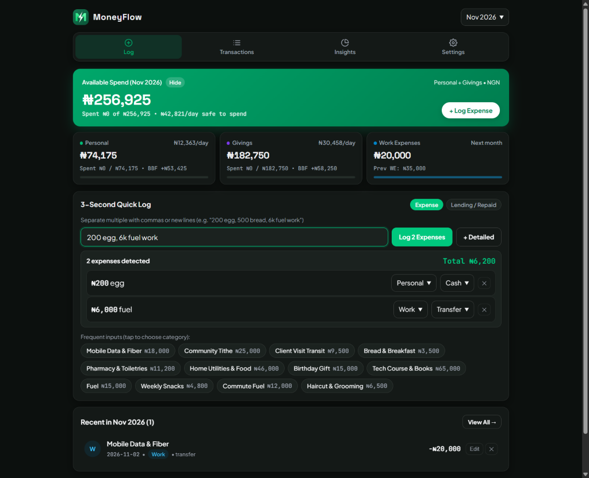
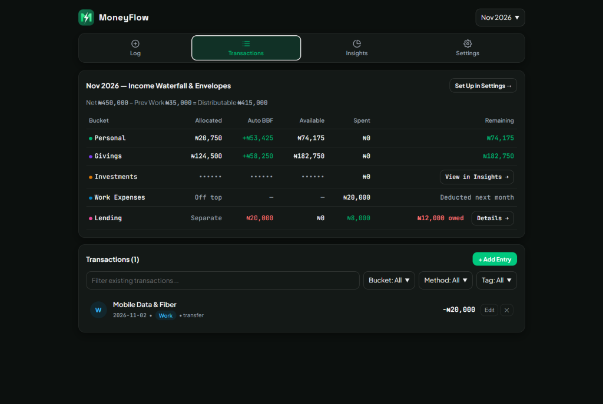
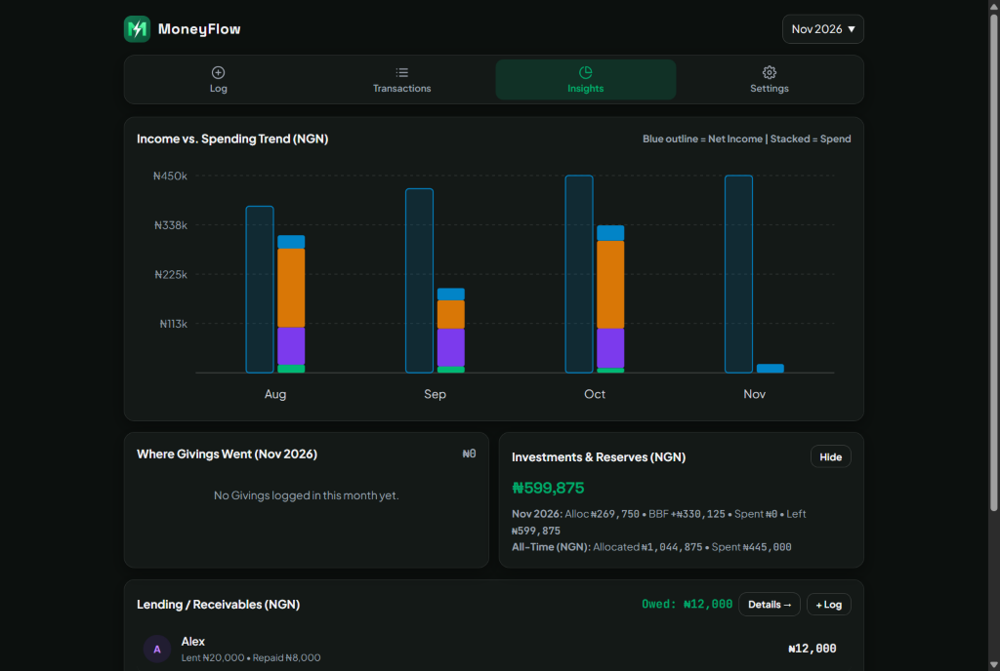
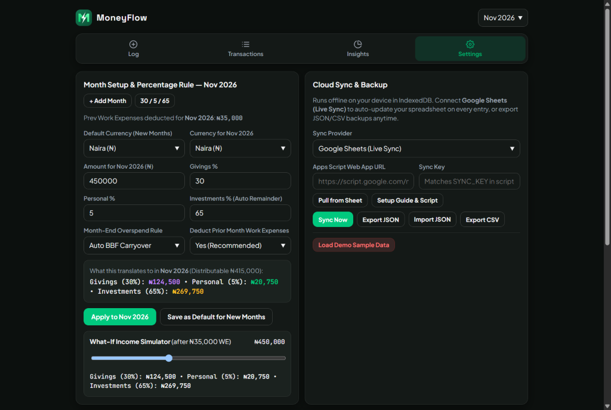

# MoneyFlow — Local-First Envelope Budgeting & Multi-Currency Cashflow PWA

> **Zero-build, offline-first personal finance PWA built to eliminate spreadsheet formula bugs, micro-expense logging fatigue, and multi-currency tracking distortion—while syncing privately with your own Google Sheet in live Naira (`₦`) FX equivalents.**

- **Executive Summary (1-Page PDF):** [`docs/MoneyFlow_Product_Brief.pdf`](docs/MoneyFlow_Product_Brief.pdf)
- **Stack:** Vanilla ES Modules · IndexedDB (`moneyflow_db`) · Service Worker PWA (`sw.js`) · Custom SVG Charts · Google Apps Script (`open.er-api.com` FX)

---

## The Problem I Built MoneyFlow to Solve

Most people who try intentional percentage-based budgeting (*Givings, Personal, Investments, Reimbursable Work Expenses*) start in Excel or Google Sheets—and abandon it within weeks. After living through that workflow firsthand, four concrete product failures stood out:

1. **Micro-Transaction Logging Fatigue ("The ₦200 Egg Problem"):**
   Small daily cash purchases (`₦200` snacks, `₦500` bread, transit fares) and multi-line bank SMS debit alerts take 30–60 seconds each to open a spreadsheet, pick the right month tab, and enter manually. High logging friction kills consistency mid-month.
2. **Silent Spreadsheet Formula Fragility:**
   Envelope budgeting requires deterministic month-to-month rules: deducting **prior-month Work Expenses off the top** before splitting new income, rolling unspent or overspent balances forward (**Auto BBF**), and tracking **unpaid peer loans** across months. Manual formulas break on sign flips, copy-paste errors, and typos (such as typing `11,OOO` with letter `O`s instead of zeros).
3. **Multi-Currency Distortion vs. Unified Home Reporting:**
   When a user starts earning or spending in `USD ($)`, `GBP (£)`, or `EUR (€)` alongside `NGN (₦)`, single-currency trackers mix numbers and corrupt historical Naira carryovers. Conversely, isolating foreign currencies shouldn't stop you from seeing a consolidated **Naira (`₦`) equivalent** on your master ledger.
4. **SaaS Lock-In vs. Data Privacy:**
   Cloud finance apps store sensitive personal financial data on third-party servers behind subscriptions, while pure offline spreadsheets trap data on one device.

---

## How MoneyFlow Works

### 1. 3-Second Expense Capture & Smart Parsing (`Log`)

Instead of opening multiple forms for every small purchase, MoneyFlow turns natural-language shorthand (`"200 egg, 6k fuel work"`), multi-line bank SMS alerts, CSV statements, and 1-tap speed chips into classified transactions in under 3 seconds.

- **Intentional Daily Focus:** Shows only daily safe-to-spend balance (`Personal + Givings`), active envelope balances, and `Work Expenses`—keeping allocation percentages and long-term `Investments` hidden from impulsive daily spend screens.
- **Instant Privacy Toggle:** One click masks home balances in public spaces.
- **Lending Toggle:** Switch directly between `Expense` and `Lending / Repaid` on the same fast screen.



---

### 2. Automated Waterfall, Auto BBF & Lending Carryover (`Transactions`)

Every log triggers a deterministic full-ledger recompute in [`app/src/budgetEngine.js`](app/src/budgetEngine.js):

- **Work Expense Off-Top Deduction:** Prior month `Work` spend is deducted from new `Net Income` before allocating `Personal`, `Givings`, and `Investments`.
- **Automatic Bring-Balance-Forward (`Auto BBF`):** Surpluses and overspends carry forward automatically across consecutive months **of the same currency** (`NGN` → `NGN`, `USD` → `USD`), preventing cross-currency corruption.
- **Persistent Lending Ledger:** Unpaid peer loans carry across months automatically until marked settled or partially repaid inside **Lending & Debt Details**.



---

### 3. Currency-Isolated Insights & Reserve Privacy (`Insights`)

- **Income vs. Spending Trend:** Custom zero-dependency SVG stacked bars compare monthly `Net Income` against category spending (`Personal`, `Givings`, `Investments`, `Work`) filtered cleanly per active currency.
- **Givings Attribution (`#family`, `#home`, `#church`, `#gifts`):** Keeps Giving in one envelope while automatically breaking down where generosity goes.
- **Protected Investment Reserves:** `Investments & Reserves` stays masked on daily tabs and includes a `Hide / Show` blur toggle in Insights.



---

### 4. Multi-Currency Setup, Simulator & Two-Way Google Sheets Sync (`Settings`)

- **Start-of-Month Check-In:** Automatically prompts at the start of a new month to confirm monthly income and continue with or adjust your percentage split (`30 / 5 / 65` default).
- **Multi-Currency Support (`NGN ₦`, `USD $`, `GBP £`, `EUR €`):** Set a default currency for new months or override per month, backed by a live allocation translation preview and **What-If Income Simulator**.
- **Two-Way Google Sheets Sync (`cloud/google-apps-script.gs`):**
  - Keeps personal data completely out of GitHub while staying synced across mobile and desktop via your own private Google Sheet.
  - **Live Official Naira (`₦`) FX Reporting:** Fetches official rates (`open.er-api.com/v6/latest/NGN` with cached fallback) and writes `Overview`, `Transactions`, and `Lending` tabs in `₦` while clearly stating `Orig Currency`, `Orig Amount`, `FX Rate (to ₦)`, and a timestamped FX rate banner on every sheet.
  - **Push, Merge & Restore (`_MoneyFlowSync`):** Stores a chunked hidden JSON snapshot inside the Sheet so **Sync Now** merges multi-device edits by `updatedAt` timestamps and **Pull from Sheet** restores your full ledger onto any new device.



---

## Architecture & Project Structure

```text
├── app/
│   ├── index.html                    # App shell, navigation tabs, modal & toast roots
│   ├── manifest.webmanifest          # Installable PWA manifest
│   ├── sw.js                         # Network-first Service Worker cache
│   ├── icons/icon.svg                # Emerald M + lightning SVG brand mark
│   ├── styles/main.css               # Auto Light/Dark OPay-inspired emerald theme
│   └── src/
│       ├── app.js                    # State management, views, modals & live previews
│       ├── budgetEngine.js           # Deterministic waterfall, BBF math, FX formatting
│       ├── parser.js                 # Multi-currency NL batch, bank SMS & CSV parser
│       ├── charts.js                 # Pure SVG trend & tag breakdown charts
│       ├── db.js                     # IndexedDB store, legacy migration & 2-way sync
│       ├── datePicker.js             # Custom inline calendar date selector
│       └── seedData.js               # Fictional portfolio demo dataset
├── cloud/
│   └── google-apps-script.gs         # Two-way Google Sheets sync + official FX engine
├── docs/
│   ├── MoneyFlow_Product_Brief.pdf   # 1-page Product Manager brief
│   └── screenshots/                  # Portfolio walkthrough screenshots
├── start-app.ps1                     # Zero-dependency PowerShell HTTP server
└── start-app.bat                     # Windows 1-click launcher
```

---

## Run Locally (Zero Build Step)

MoneyFlow runs purely on standard browser ES Modules:

```powershell
# Windows (PowerShell — zero dependencies)
.\start-app.ps1
# Opens http://localhost:8765
```

Or with Python / any static server:

```bash
python -m http.server 8765 --directory app
```

---

## Connect Your Own Private Google Sheet Sync

1. Open a private Google Sheet → **Extensions → Apps Script**.
2. Paste [`cloud/google-apps-script.gs`](cloud/google-apps-script.gs) and replace `SYNC_KEY` with your own secret key.
3. Click **Deploy → New deployment → Web app** (*Execute as: Me*, *Who has access: Anyone*).
4. In MoneyFlow → **Settings → Cloud Sync & Backup**, select **Google Sheets (Live Sync)**, paste your Web App URL and `SYNC_KEY`, and click **Sync Now** (or **Pull from Sheet** on a fresh device).
